<div align="center">

# The Observer

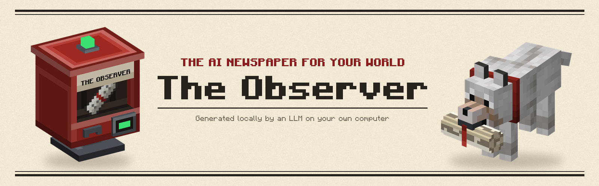


<br>
<a href="https://fabricmc.net"></a>
<a href="https://neoforged.net"></a>

## The AI newspaper for your Minecraft world

Every week, a language model running on your own computer reads everything that happened in your world and writes
it up as a newspaper: who beat the Ender Dragon, who struck diamonds and then lava, who built half a castle, who died
six times and still won't talk about it. A delivery dog brings it to your door.

<!-- TODO: download and version badges (Modrinth, CurseForge) once The Observer is published there. -->

</div>

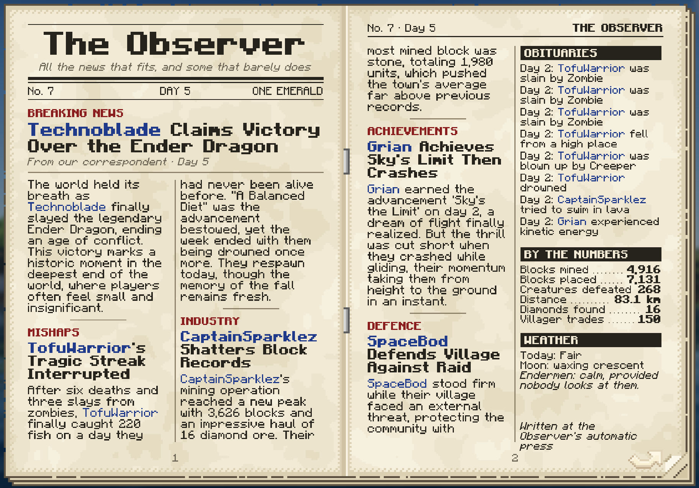

---

## Why The Observer

A good server week is full of moments: the night someone finally killed the Wither, the raid you barely survived, the
mega-build that went up while you were at work. By next week they're gone, buried in chat and half-remembered.

The Observer keeps them. Each edition is written fresh by an AI from what actually happened, so every story is about
your world and your friends, told in the voice of a proud small-town paper (or a merciless roast, or an epic saga).
Log in after a few days away and catch up on everything you missed in five minutes of reading. Keep every edition on
a bookshelf, and your world builds its own history: a shelf of front pages you can take down and reread, from the
first night to the hundredth dragon.

It needs no setup and works in singleplayer and on servers. The model runs on your computer, so nothing about your
world ever leaves it.

## What's inside

- [Written by AI, on your computer](#written-by-ai-on-your-computer)
- [The newspaper](#the-newspaper)
- [The news](#the-news)
- [Your world's history, on a shelf](#your-worlds-history-on-a-shelf)
- [The Exchange](#the-exchange)
- [The newsstand](#the-newsstand)
- [The Pawstman](#the-pawstman)
- [The Editor's Desk](#the-editors-desk)

## Written by AI, on your computer

The Observer has a whole newsroom inside it, and every member of staff is a small language model running locally:

1. **The editor** reads a file on every player who did something worth printing: what they did, how it compares with
   their usual week and with everyone else, what the paper said about them last time. Then it plans the edition: an
   angle for each story, and now and then a quote from one of the townsfolk.
2. **The reporters** write each story several times over, in the paper's voice.
3. **The sub-editor** checks every draft against the facts before it goes to print. Every number, every name and every
   quote must be real; the best draft that passes is printed.
4. **The letters page** fills up with letters and opinion columns from the townsfolk.

The model is downloaded once, from inside the game (533 MB, or 1.3 GB for the quality model), and runs on your
graphics card (Vulkan or Metal) or your CPU. An edition takes well under a minute on a mid-range card. Nothing is sent
anywhere.

**Three voices** to choose from:

| Voice | |
|---|---|
| **The Broadsheet** (default) | A proud small-town paper reporting your blocky adventures with complete seriousness and a dry wit. |
| **The Roast** | No resident is safe. Every story is a joke at somebody's expense: deaths, blunders and bragging all fair game. |
| **The Chronicle** | Every deed a legend, every player a hero of the age. |

Rather not download a model? The Observer writes every edition from its built-in house templates instead: the same
paper and the same news, in a fixed set of phrasings. See [The press](docs/press.md).

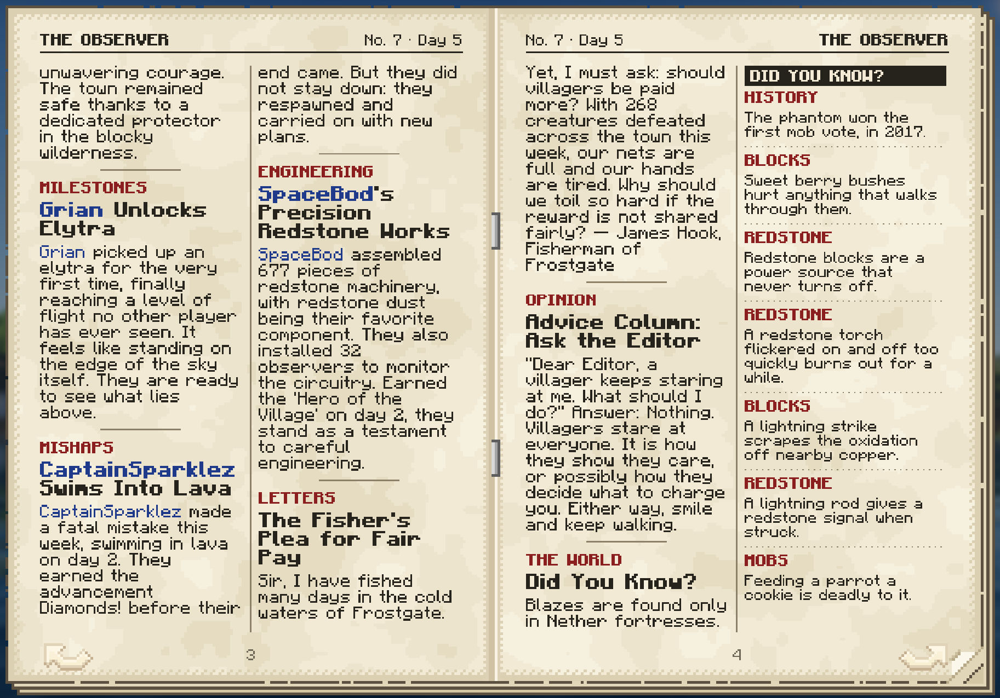

## The newspaper

Right-click the paper to open it: a stapled newspaper you leaf through with page-turn arrows.

- **The front page.** The masthead, the week's lead story across the top, more news in columns, and a sidebar with the
  obituaries, the town's numbers and the weather.
- **More news,** letters and opinion columns from the townsfolk, small ads, and a **Did You Know?** column of real
  Minecraft trivia.
- **The Exchange,** your own page of jobs for the townsfolk (see [below](#the-exchange)).
- **The Leaderboard and the Hall of Fame:** who led the town at what this week, and the all-time records.

Players' names are printed in blue, so you spot yourself (and your friends) at a glance.

<p>
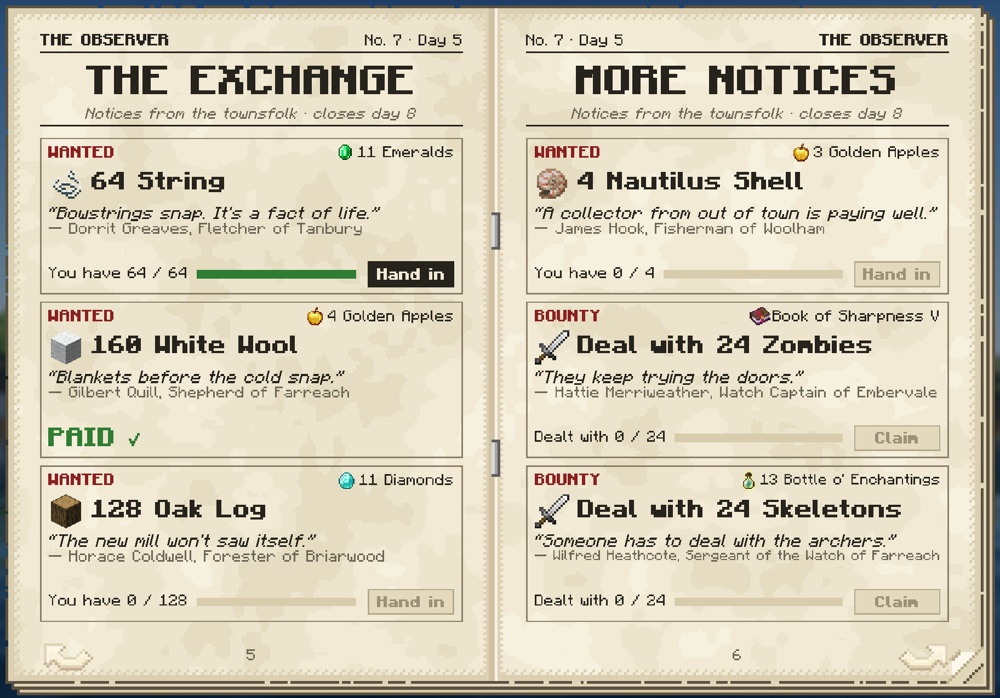
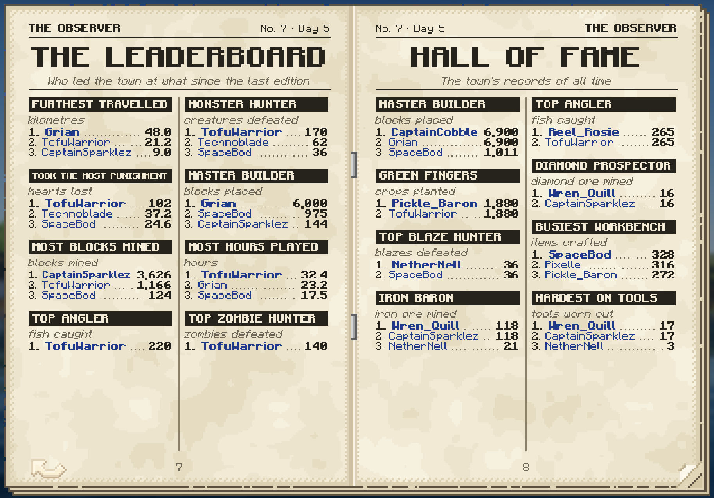
</p>

## The news

The paper reads the statistics Minecraft already keeps on every player, plus every death and advancement as it
happens, and works out what's worth printing:

- **The big moments lead.** A dragon or a Wither slain always takes the front page.
- **Firsts.** About 60 milestones: the first diamond pickaxe, first steps in the Nether, the first enchantment.
- **New habits and record weeks,** measured against each player's usual week: "took up redstone", "a record harvest:
  1,400 crops, usually about 160".
- **Stories that connect.** A death that follows from something else is told as one story: crashing while gliding the
  week you found elytra, a swim in lava the week you found diamonds, being killed by the very creatures you spent the
  week hunting.
- **The whole town.** Every player who has ever joined is in the paper, online or not, so the first edition on an
  existing world already knows everyone.
- **Daily, weekly or fortnightly.** The paper comes out on the schedule you choose, and the wording, comparisons and
  Exchange all follow it.

## Your world's history, on a shelf

Papers keep. Put them on a chiseled bookshelf and they stay there like books, every story, letter and Exchange notice
intact. Build a reading room, file every issue in order, and your world has its own archive: the week the server
started, the first dragon, the great cactus-farm flood. Take one down any time and reread it.

## The Exchange

Every reader gets six notices of their own from named townsfolk (farmers, masons, librarians, toolsmiths and more) and
the Watch: four deliveries ("WANTED: 128 wheat") and two monster jobs ("Deal with 12 zombies"). Notices are pitched to
how far you've got, paid at the generous end of villager prices in emeralds, goods and enchanted books, and checked by
the server. Progress shows live on the page, with **Hand in** or **Claim** when it's done, and finished jobs make the
next edition's news.

## The newsstand

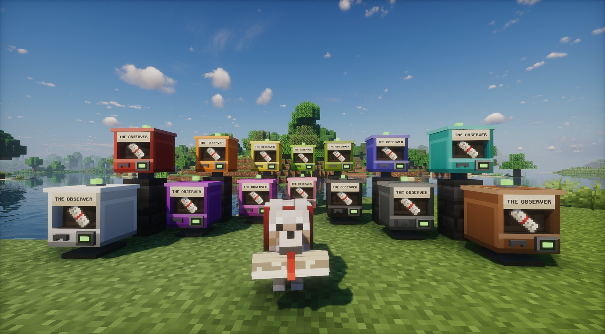

A painted vending box on a post, where anyone can pick up the latest edition.

- **Your copy at a glance.** The window shows a fresh paper while your copy is waiting and is empty once you've had
  it. Its lamps (the coin slot and the bulb on the lid) glow green while your copy waits, red once you have it and
  orange while the next edition is at the press. Every player sees their own.
- **A new edition arrives** with the bell ringing and the stand sparkling.
- **Any colour.** It comes in red; use any dye on it to repaint it.

<p>
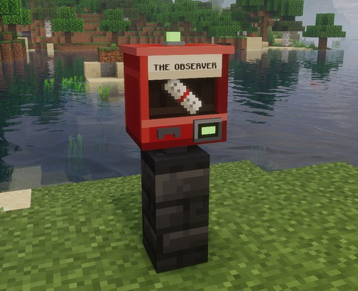
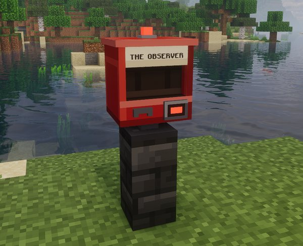
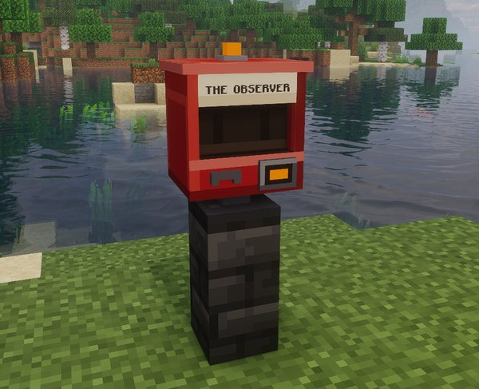
</p>

**Crafting.** Emeralds, iron ingots, two glass panes (any colour), paper and a wooden chest:

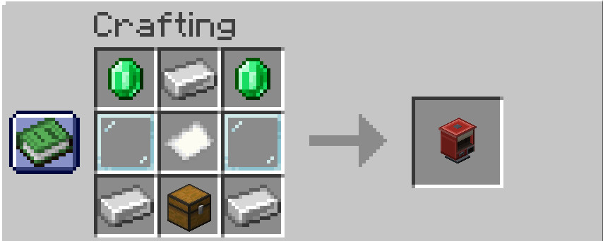

**The counter.** Right-click the stand for the status, a live countdown to the next edition, your copy (bought through
the coin slot, spares too) and your choice of delivery: the Pawstman, or collecting here.

## The Pawstman

<p>
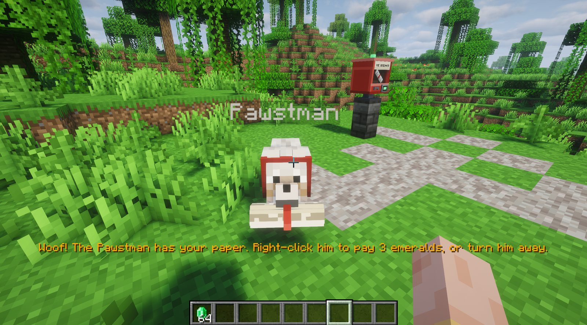
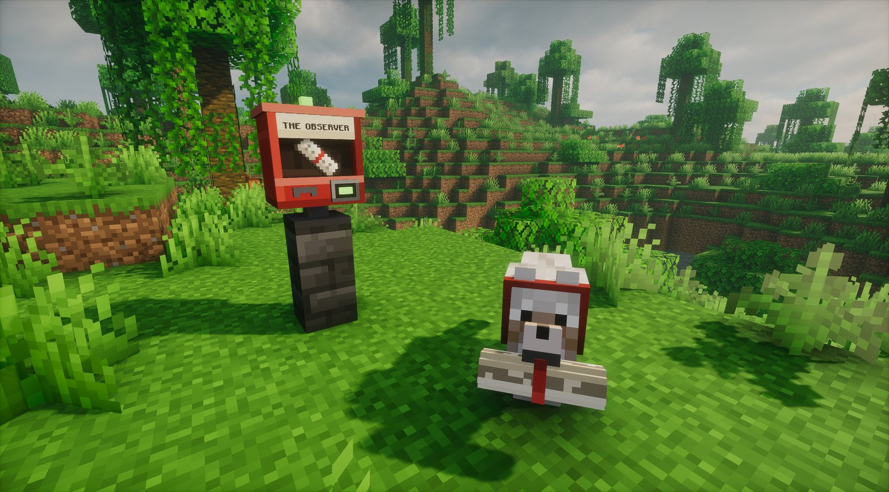
</p>

The paper's delivery dog, in a red collar. When a new edition comes out he appears somewhere out of sight and trots
over with your copy rolled up in his mouth.

- **Paying.** He follows you, barking, until you right-click him. His counter takes the price in its coin slot (one
  emerald by default); **Pay & take** the paper or say **No thanks**. Your first copy is on the house.
- **Saying no.** Turn him away and he takes the paper home; buy it at a newsstand whenever you like. If your pockets
  are empty he doesn't pester you.
- **He always finds you.** Like a tamed wolf, he teleports to your side when there's no way through. If he truly can't
  reach you, your copy waits at the nearest newsstand.

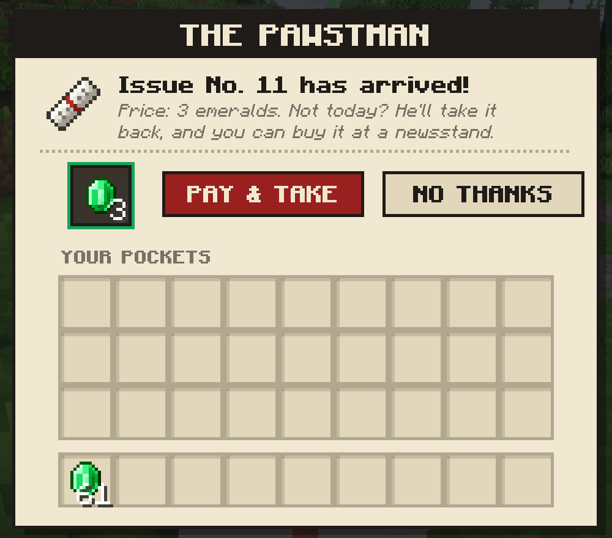

## The Editor's Desk

Operators run the paper from the Editor's Desk, folded beside every newsstand's counter: the paper's voice, how often
it comes out, whether it publishes on its own, the Exchange's rewards, the Pawstman's duty and price, whether the
first copy is free, and a button to publish an edition right now.

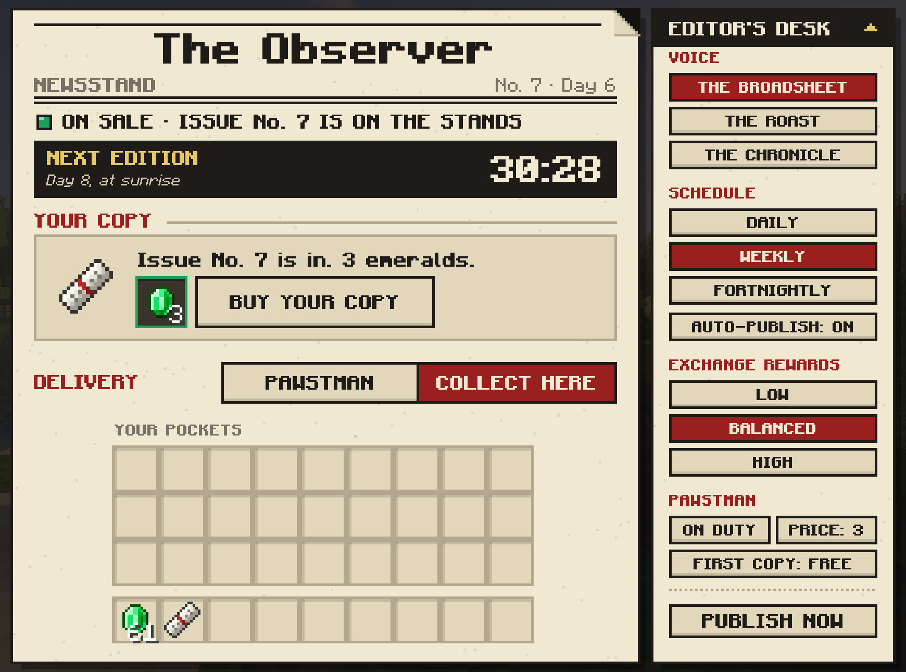

## Getting started

The first edition comes out at sunrise, and the Pawstman brings everyone their first copy free.

1. **Read the paper.** Right-click the Pawstman to take your copy, then right-click the paper to read it.
2. **Earn some emeralds.** Do a notice on the Exchange and press **Hand in** or **Claim** on its page.
3. **Pay for the next one.** From the next edition a copy costs an emerald: pay the Pawstman at the door, or buy it at
   a newsstand later.
4. **Build a newsstand** once you're trading with villagers, and pick up your paper whenever you like.
5. **Start a shelf.** Keep every edition on a chiseled bookshelf.

## Requirements

| Requirement | Version or details |
|---|---|
| Minecraft | 26.1, 26.2 or 26.3 |
| Mod loader | Fabric Loader 0.19.5+ with Fabric API, or NeoForge |
| Side | Both: the server writes and delivers the paper, clients need the mod to read it |
| Writing model | Downloaded in game: 533 MB (standard) or 1.3 GB (quality). Runs on the GPU (Vulkan or Metal) or the CPU |

## Installation

1. Install Minecraft 26.1, 26.2 or 26.3 with Fabric (and Fabric API) or NeoForge.
2. Put the jar for your Minecraft version and loader into your `mods` folder, on the server too.
3. Start the game and open a world. The Observer offers to download a writing model and recommends one for your
   computer. On a dedicated server, run `/observer model download standard`.

<!-- TODO: download links once published. -->

## Documentation

| Page | What it covers |
|---|---|
| [Features](docs/features.md) | Everything in detail: the paper, the news, the archive, the Exchange, the newsstand, the Pawstman |
| [The press](docs/press.md) | The AI newsroom: how an edition is written and checked, the models, GPU and CPU, tuning, template mode |
| [Configuration](docs/configuration.md) | Every command, every setting and where the files live |
| [Development](docs/development.md) | Building, the test suite, the scenario gallery and the demonstration town |
| [Changelog](CHANGELOG.md) | What changed in each version |

## Building from source

Building needs JDK 25:

```bash
./gradlew build
```

The jars are written to `fabric/build/libs/` and `neoforge/build/libs/`; `release.ps1` builds every supported
Minecraft version. [Development](docs/development.md) covers dev runs and the tests.

## Credits

- **[llama.cpp](https://github.com/ggml-org/llama.cpp)**, the engine that runs the writing model, through the
  **[java-llama.cpp](https://github.com/bernardladenthin/java-llama.cpp)** binding.
- **[Qwen3.5](https://huggingface.co/Qwen)** by the Qwen team, the writing models (Apache-2.0), in the GGUF builds
  published by [Unsloth](https://huggingface.co/unsloth).
- **[Jackson](https://github.com/FasterXML/jackson)**, bundled for the binding.

## License

The Observer is free software under the MIT licence: use it, include it in modpacks, change it and share it, as long
as the licence and copyright notice come along. See [`LICENSE`](LICENSE).
